# AWS Lambda + DynamoDB + S3 Backup Report

## Overview
This project demonstrates a serverless data pipeline that imports sample user records from a public API into DynamoDB, then exports the data as JSON backup files into a private Amazon S3 bucket. The export is automated with EventBridge Scheduler so it runs every 2 minutes.

The solution uses:
- AWS Lambda for both import and export logic
- Amazon DynamoDB for persistent storage
- Amazon S3 for JSON backups
- EventBridge Scheduler for recurring automation
- Amazon CloudWatch for monitoring and log review

---

## 1. Architecture

```text
https://jsonplaceholder.typicode.com/users
        |
        | HTTP GET
        v
[Lambda #1: import-jsonplaceholder-users]
        |
        | PutItem
        v
[DynamoDB: jsonplaceholder-users]
        |
        | Scan
        v
[Lambda #2: export-dynamodb-to-s3] <-- [EventBridge Scheduler rate(2 minutes)]
        |
        | PutObject
        v
[Private S3 bucket]
    backups/YYYY-MM-DD/users-...json
```

Lambda #1 is manually invoked to populate the table. Lambda #2 reads the DynamoDB data and writes timestamped JSON exports to S3. Both functions emit logs to CloudWatch for troubleshooting and validation.

---

## 2. DynamoDB setup
The table was created as `jsonplaceholder-users` with the following configuration:
- Table name: `jsonplaceholder-users`
- Primary key: `id` (Number)
- Status: Active
- Item count: 10 sample records

Screenshot evidence:

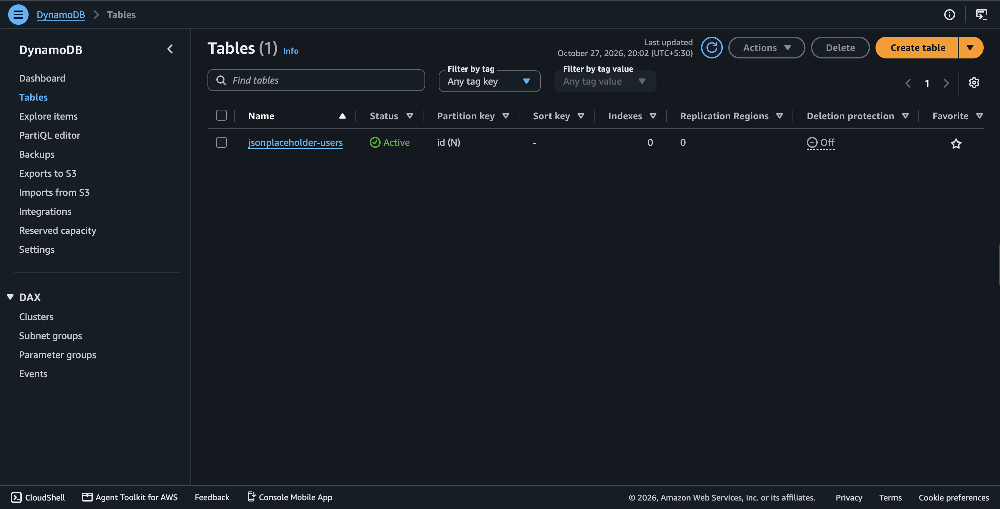

This confirms the DynamoDB table was created in the expected region and is using a numeric partition key (`id`). The table holds the imported user data from the public JSONPlaceholder API.

---

## 3. S3 bucket setup
A private S3 bucket was created to store the backup files. The bucket was kept private and used as the destination for the export Lambda.

Screenshot evidence:

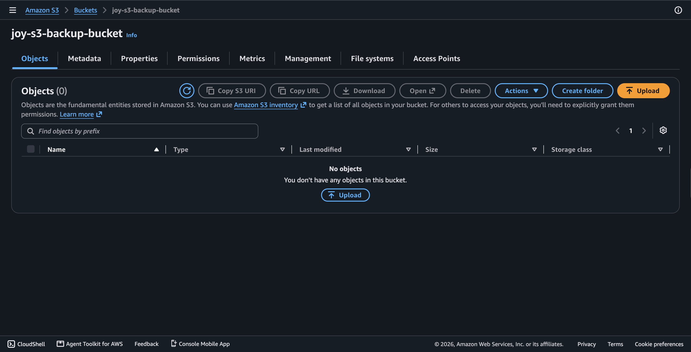

The S3 bucket acts as the durable backup target for the exported user records. Each export is stored under a `backups/` prefix with a unique timestamped file name.

---

## 4. Lambda #1: Import users into DynamoDB
The first Lambda function, `import-jsonplaceholder-users`, calls the public JSONPlaceholder API, receives 10 user records, and writes each record to DynamoDB using `PutItem`.

### Configuration and function behavior
- Function name: `import-jsonplaceholder-users`
- Runtime: Python 3.x (Lambda managed runtime)
- Handler: `lambda_function.lambda_handler`
- Purpose: fetch users and save them to DynamoDB

Screenshot evidence:

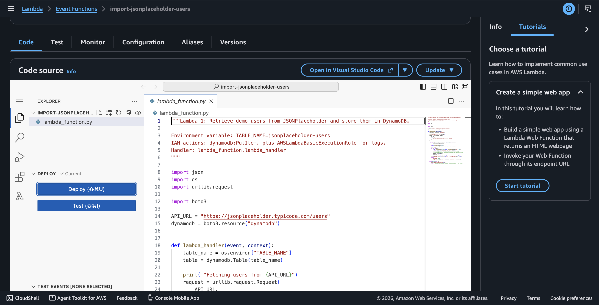
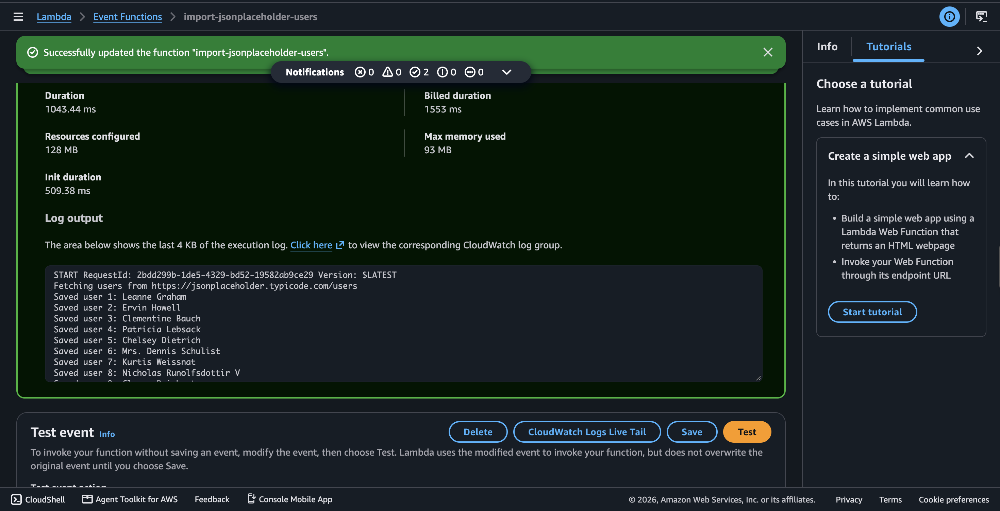
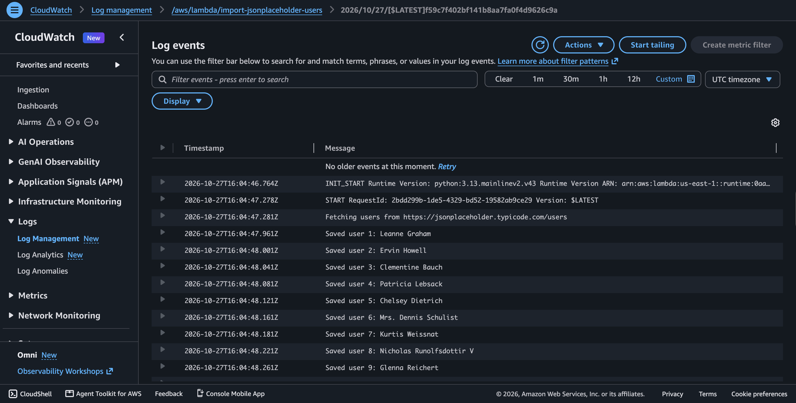

The successful execution confirms a `statusCode` of `200` and a saved count of 10 records. The log output shows calls like `Fetching users from https://jsonplaceholder.typicode.com/users` followed by successful `Saved user ...` entries for each record.

---

## 5. Lambda #2: Export DynamoDB data to S3
The second Lambda function, `export-dynamodb-to-s3`, scans DynamoDB, converts the records to JSON, and uploads the result to the S3 bucket. Each invocation produces a new object with a timestamped key so it does not overwrite previous backups.

### Configuration and function behavior
- Function name: `export-dynamodb-to-s3`
- Runtime: Python 3.x
- Handler: `lambda_function.lambda_handler`
- Purpose: read all users from DynamoDB and store a JSON backup in S3

Screenshot evidence:

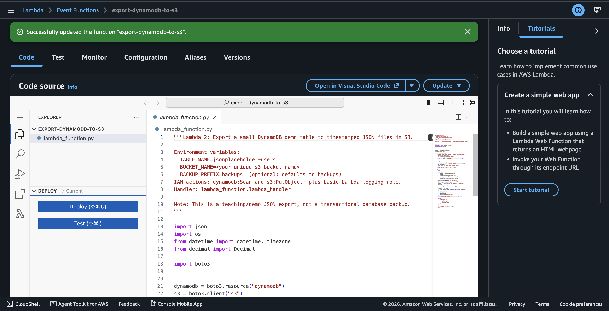
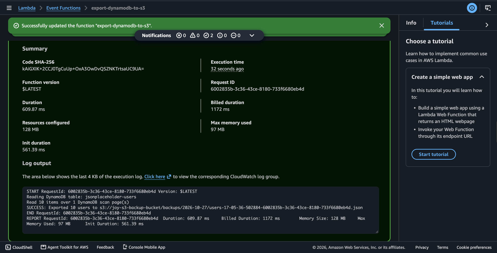
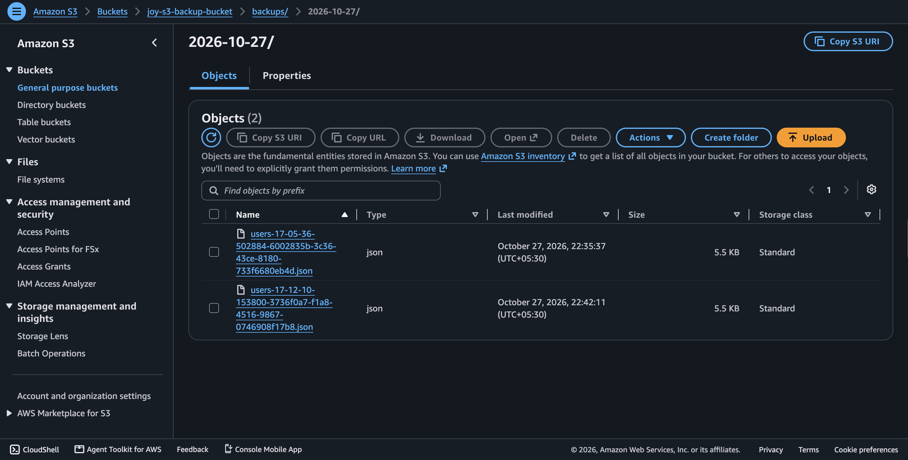

The export result shows the function successfully scanned the table and uploaded a JSON export to S3. The object name reflects time-based uniqueness, which prevents older objects from being overwritten.

---

## 6. EventBridge Scheduler automation
An EventBridge schedule was configured to invoke the export Lambda every 2 minutes. This demonstrates automation of the backup process without manual intervention.

Screenshot evidence:

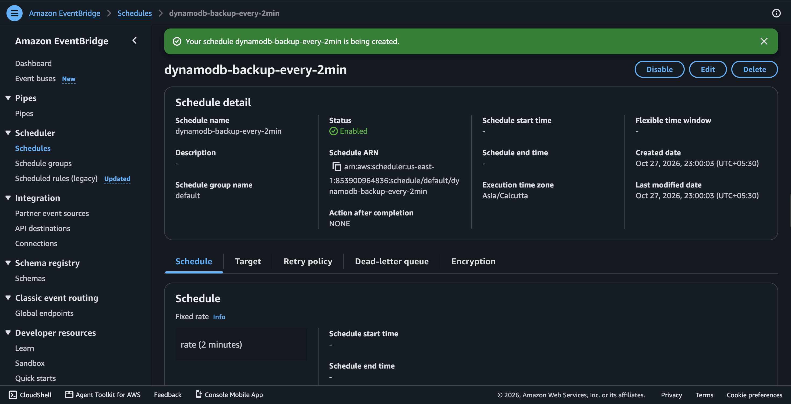
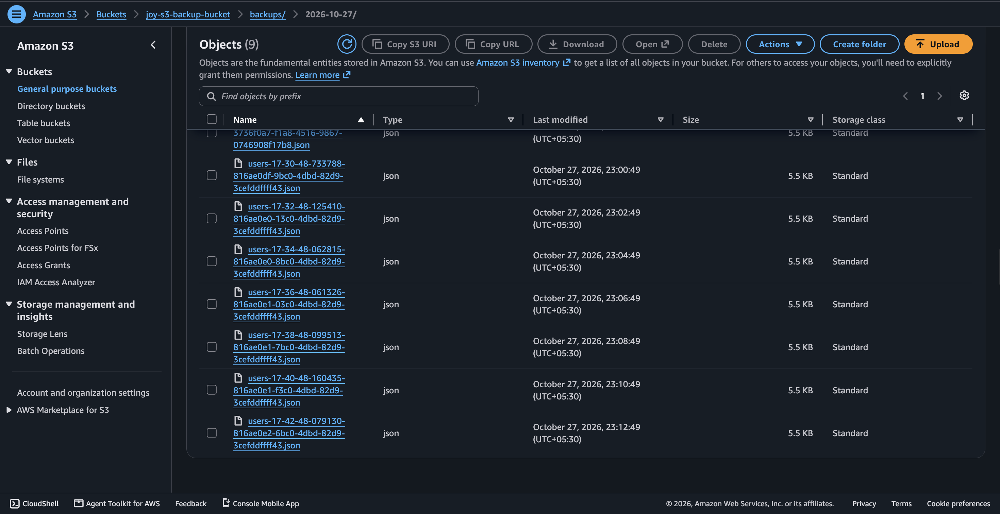
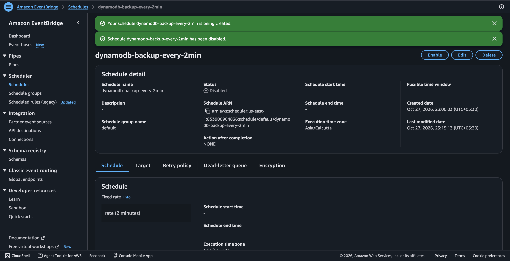

The scheduled backup pattern created multiple timestamped files over time. The disabling screenshot confirms the schedule can be paused once the lab work is complete.

---

## 7. Monitoring and observability
Both Lambda functions write to CloudWatch Logs, which makes it possible to confirm execution results and diagnose issues. The logs also provide evidence of successful imports, exports, and run timestamps.

Screenshot evidence:

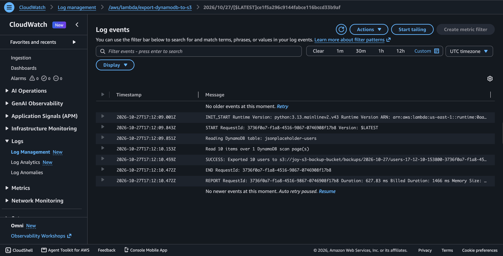

This log output shows the export process completing successfully and recording the exported record count and S3 output path. CloudWatch is essential for verifying execution success and tracing operational behavior.

---

## 8. Key lessons learned
1. DynamoDB tables use a primary key to ensure each item is uniquely identified.
2. Lambda functions can work together as a serverless pipeline: API fetch -> DynamoDB write -> scan/export -> S3 backup.
3. IAM permissions should follow least-privilege principles: the import function only needs write access to the table, and the export function only needs read access to the table and write access to the backup bucket.
4. EventBridge Scheduler allows reliable, recurring automation without manual invocation.
5. CloudWatch logs are critical for proving execution success and investigating failures.

---

## 13. Questions and Answers

### 1. What is the difference between Lambda's execution role and Scheduler's execution role?

**Simple answer:** The two roles have different jobs.

- **Lambda execution role:** Gives the Lambda function permission to do its work, such as writing to DynamoDB, reading DynamoDB records, saving files to S3, and writing logs.
- **Scheduler execution role:** Gives EventBridge Scheduler permission to start the target Lambda function at the scheduled time.

In short, Scheduler's role starts the function, and the Lambda role lets the function access the AWS services it needs.

### 2. Why does running Lambda 1 twice not produce 20 DynamoDB users?

**Simple answer:** DynamoDB uses `id` as the partition key. When Lambda 1 writes a user whose `id` already exists, `PutItem` replaces that item instead of creating a duplicate. So importing the same 10 users twice normally leaves 10 items, not 20.

### 3. Why do Lambda 2 backups have unique timestamps and request IDs?

**Simple answer:** Each time Lambda 2 runs, it adds the current time and the Lambda request ID to the S3 filename. This helps give each backup a different name, so one backup does not overwrite another. The request ID can also help us find the matching Lambda run in the logs.

### 4. What is the difference between `print()` logs and `Invocations` / `Errors` metrics?

**Simple answer:** `print()` writes messages about what the code is doing. These messages can be viewed in CloudWatch Logs. For example, the code can print how many records it exported.

- **Invocations metric:** Counts how many times Lambda was called.
- **Errors metric:** Counts how many invocations failed.

Metrics show counts and trends. Logs help us understand what happened during a particular run.

### 5. What would happen if the DynamoDB table were deleted but the JSON files remained in S3? Could the original indexes/configuration be automatically restored from JSON alone?

**Simple answer:** The JSON files in S3 would still be there, unless they were also deleted. We could use the files to put the saved records into a newly created DynamoDB table.

However, the JSON data alone does not automatically restore the original table settings, indexes, permissions, alarms, or capacity configuration. Those settings would need to be created again separately. The JSON files contain the exported data, not a complete copy of the whole DynamoDB setup.

### 6. Why is an export every two minutes usually a poor production backup strategy for large DynamoDB tables?

**Simple answer:** Exporting the whole table every two minutes can create many files, increase AWS costs, use DynamoDB read capacity, and take too long as the table grows. The data may also change while the scan is running, so the export is not necessarily a perfect snapshot of one moment in time.

For production backups, consider DynamoDB Point-in-Time Recovery (PITR) and DynamoDB's managed Export to S3. Choose a backup frequency and retention period based on how much data the application can afford to lose, and test that the backups can actually be restored.

